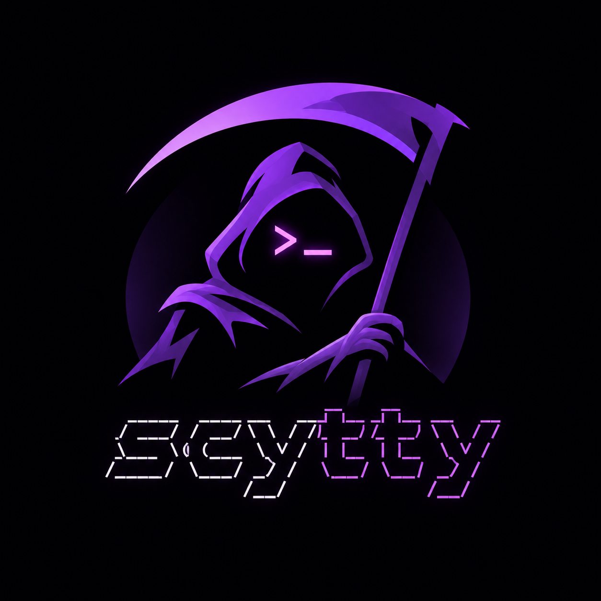

<p align="center">
  
</p>

# scytty


A minimal native terminal in Rust: GPUI draws the window,
libghostty-vt (via `ghostty-vt`) interprets terminal output, and
`portable-pty` runs your login shell. This uses Ghostty's VT library,
not the full Ghostty application embedding API.

## Workspace

- `crates/gui/` — `scytty`: GPUI client, terminal rendering, SSH transport and system font discovery
- `crates/server/` — `scytty-server`: sessions, tabs, PTYs and server-side Ghostty state
- `crates/common/` — `scytty-common`: compressed binary protocol and local connection bootstrap

The GUI does not depend on the server crate; both share only `scytty-common`.

## Run

Requires Rust 1.96+, Zig 0.17.x on PATH (or set `ZIG`), a C/C++ build
toolchain, and internet access for the first build. The Ghostty binding
build downloads and compiles its pinned upstream source. macOS also requires
Xcode command-line tools and a Metal-capable GPU. GPUI compiles Metal shaders at
runtime, so the optional Metal compiler toolchain is not required.

```sh
cargo build --release --workspace  # build GUI and server
cargo run -p scytty --release         # create or attach the "default" session
cargo run -p scytty --release -- work # create or reattach named session
```

Locally, the GUI launches `scytty-server --stdio` from beside the GUI executable
or PATH, using the same stdio bridge as SSH. The bridge connects to the private
Unix socket and starts the persistent daemon if needed.
Window size and position are saved on normal exit and restored on launch.
The last saved geometry is shared across sessions; configured dimensions are
used when no saved geometry exists. GPUI stores geometry in
`$XDG_STATE_HOME/scytty/window` (default `~/.local/state/scytty/window`);
the former egui geometry is not imported.

One window can attach to each session.
Every shell started by the server receives `SCYTTY_SESSION` set to its session name
(including over SSH).
Closing a local or SSH window detaches and preserves its session and shells. Reopen the
same session name (`default` when omitted) to restore its tabs and terminal snapshots.
Closing the last tab deletes the session and closes the window. After an established
connection drops, the GUI automatically reconnects to the same local or SSH session,
retrying after 1, 2, 4, 8, 16, then 30 seconds (capped). The last screen stays visible
with a reconnect banner; keyboard input is discarded while disconnected, never
buffered or replayed. Reattachment restores fresh terminal snapshots. Initial
connection failures, rejected sessions, and incompatible servers still show an error;
reconnect never approves a daemon restart or takes over another attached window.
The socket and server log live in `~/.scytty`. Sessions do not survive server restart;
if the session no longer exists, reattachment creates a new shell.

The default font is the system **monospace** family at 16pt. No fonts are bundled.
Install and select a Nerd Font to display the status bar's icons.

## Just commands

```sh
just build          # release GUI + local/embedded remote servers; macOS also creates target/release/Scytty.app
just run            # build and launch GUI without installing; accepts session / --ssh arguments
just install        # build and copy the macOS app to ~/Applications
just build-server   # native release server only
just build-servers  # bundle Linux x86_64/ARM64; on macOS, also macOS ARM64/x86_64
just build-linux    # Linux x86_64 server, using Zig (glibc 2.28+)
just install-linux  # cross-build and install to 192.168.1.2:~/.local/bin
```

`just build` / `just build-servers` install the needed Rust targets and require
Zig on PATH. Linux payloads are statically linked with musl; macOS payloads can
only be built on macOS. `just build` embeds everything in `target/server-bundle`.
For a GUI-only development build with existing payloads:

```sh
SCYTTY_SERVER_BUNDLE="$PWD/target/server-bundle" cargo build -p scytty
```

Plain Cargo GUI builds without this variable have no remote payloads and report
that limitation when connecting. Windows developers can populate this directory
from the workflow's `server-bundle-*` artifacts before building.

The older `just build-linux` / `just install-linux` commands remain available for
manual glibc 2.28+ deployment; they require the `x86_64-unknown-linux-gnu` Rust
target. Manual installation does not restart the remote daemon.

## GitHub Actions builds

The `Build` workflow runs only when a tag is pushed. After all builds and tests
succeed, it creates a GitHub Release for that tag with downloadable archives:

- macOS ARM64: desktop `.app` bundle; ARM64 and x86_64 standalone servers.
- Linux x86_64 and ARM64: statically linked musl server archives.
- Windows x86_64: GUI and matching local server executable archive (ConPTY).

Extract the desktop archive and move `Scytty.app` into Applications. Its matching
server is bundled inside, so no separate server installation is needed locally.
The app is ad-hoc signed, **not notarized**; macOS Gatekeeper may block it until
explicitly allowed in System Settings.

On Windows 10 version 1809 or later, extract both executables into the same
folder and run `scytty.exe` for a local session. The server starts automatically
and sessions survive closing the GUI. Run `scytty.exe --ssh user@host [session]`
for remote Unix sessions; OpenSSH (`ssh.exe`) must be on PATH, with no manual
remote server installation needed. Both desktop archives embed all four
remote server variants. To build locally, use Rust, Zig and the MSVC build tools;
set `SCYTTY_SERVER_BUNDLE` as described above to include remote payloads.

Publish a release with `git tag v0.1.0 && git push origin v0.1.0` (use a new tag
for each release).

## Configuration

The GUI evaluates `~/.config/scytty/config.lua` with bundled **LuaJIT** on startup
(or `$XDG_CONFIG_HOME/scytty/config.lua`). Return a table:

```lua
return {
  font_size = 16,
  background_opacity = 0.8,
  window_width = 960,
  window_height = 640,
}
```

See `config.example.lua`. Missing options use defaults; unknown options and
invalid values are errors. Config applies to terminal and tab-bar fonts.
Set `font_family = "Menlo"` (or another installed family name) to select a font.
The default `"monospace"` selects the system monospace family. The regular face
is used; unknown families produce a startup error. No bundled glyph fallback is
provided. Choose a monospace family for correct terminal alignment.
Restart the GUI to reload. Only load trusted config: this is executable Lua.

Customize the native window title with `format_window_title = function(ctx)
return ctx.session .. " - " .. ctx.title end`. It receives `session`, the active
tab's `title`, and `remote` (boolean), and must return a string.
Server settings and custom keybindings are not configurable yet.

Modules beside `config.lua` work with `require()`, including `module/init.lua`.
For example, `config.format_tab = require("format-tab-title")` loads
`~/.config/scytty/format-tab-title.lua`, which should return a callback. Settings
modules can return a function and apply it with `require("settings")(config)`.
No working-directory change or WezTerm API shim is required.

The bar is a single transparent monospace text row, with clickable tabs and `+`.
It occupies the titlebar area beside the native macOS window buttons; drag empty
bar space to move the window. The native title text is hidden.
Defaults show plain tab titles (white active, gray inactive), a 25-character
tab limit, and empty left/right status. Override `left_status`, `format_tab`, or
`right_status` with Lua functions (see `config.example.lua`). Each receives a table
with `remote` and `user_vars` (the active tab's OSC 1337 variables);
`format_tab` also receives `title`, `index` (1-based), and `active`, and its own
 tab's `user_vars`.
Return a string or an array of `{text = "...", color = "#RRGGBBAA"}`
segments. Color is optional. Nerd Font icons followed by a space enlarge into
that space automatically. Set `icon_scale = 1.5` (default; range 1–3) to configure their
enlargement in both the terminal and status bar. Icons remain clipped to the row.
Custom command icons, themes and status animations belong in your Lua config;
Rust has no ghost-specific rendering logic.
Callbacks run on GUI redraw; the GUI refreshes once a second for clocks.
This is a scytty API, not a WezTerm compatibility layer. To display shell status,
your `right_status` callback can return `ctx.user_vars.right_status or ""`.
Variables are set with `OSC 1337;SetUserVar=NAME=BASE64_VALUE`, terminated by BEL
or ST; they survive detach/reattach and work over SSH. Limits: 64 variables per
tab, 128-byte alphanumeric/underscore names and 4096-byte UTF-8 values. ANSI foreground colors in status text support
16-color, 256-color and truecolor SGR sequences; reset restores the segment's
Lua color. Other terminal controls and styling are ignored.

```sh
printf '\033]1337;SetUserVar=right_status=%s\007' "$(printf 'building ' | base64 | tr -d '\n')"
printf '\033]1337;SetUserVar=right_status_timestamp=%s\007' "$(date +%s | tr -d '\n' | base64 | tr -d '\n')"
```

Progress uses OSC 9;4 and is exposed to the same callbacks as `ctx.progress`:
`nil` when cleared, otherwise `{state = "normal", percent = 42}`. States are
`normal`, `error`, `indeterminate`, and `paused`; `percent` is nil when omitted.
Status callbacks receive the active tab's progress; `format_tab` receives its
own tab's progress. It survives detach/reattach, including over SSH. The active
tab also updates native icon progress automatically: each Windows window's taskbar
button, or the macOS Dock icon for the most recently focused window. Switching
tabs, clearing progress, disconnecting, or closing the window clears stale progress.
Windows shows native normal/error/paused/indeterminate states; macOS uses a
percentage bar or a moving segment for indeterminate work, without distinct
error/paused colors.
Lua status text remains opt-in, for example:

```lua
right_status = function(ctx)
  local p = ctx.progress
  if not p then return "" end
  return p.state .. (p.percent and (" " .. p.percent .. "%") or "")
end,
```

```sh
printf '\033]9;4;1;42\007' # normal, 42 percent
printf '\033]9;4;0\007'    # clear
```

### Program status (OSC 7501)

`format_tab`, `left_status`, and `right_status` also receive `ctx.state`:
`nil` with no reports, otherwise the
most recently updated surviving record's state (`idle`, `working`, `done`,
`blocked`, or `error`). This is not an aggregate of concurrent tasks.
`ctx.program_status` contains all reports keyed by ID; `""` is the root record.
Each has `state` and optional `app`, `kind`, `progress`, `title`, and `message`.
For example:

```lua
format_tab = function(ctx)
  return ctx.title .. (ctx.state and (" [" .. ctx.state .. "]") or "")
end,
```

```sh
printf '\033]7501;state=working:app=cargo:progress=40\007'
printf '\033]7501;state=blocked:id=build:kind=permission:msg=QXBwcm92ZT8=\007'
printf '\033]7501;state=clear\007'
```

`title` and `msg` on the wire are base64 UTF-8; Lua receives decoded plain text.
Reports replace their whole record; omitted fields disappear. A missing `app`
inherits from the nearest ancestor. Clearing an ID also clears its descendants;
clearing without an ID or a terminal reset clears everything. New shell prompts
(OSC 133 A) discard idle/working/blocked records; done/error records remain until
cleared by the sender or reset. Closing a tab removes its records. Each tab keeps
at most 256 records, evicting the least recently updated. State survives
reattachment, including SSH. Support queries are answered by the server.
These are untrusted program-provided values; no badges, notifications, or
OSC 9;4 progress updates are triggered automatically.

This changes tab metadata on the wire: update both GUI and server and restart
the daemon when safe (restarting ends existing sessions).

## Default shortcuts

- **Cmd+F** on macOS, **Ctrl+Shift+F** elsewhere: search the active tab's buffer,
  including scrollback. **Enter / Shift+Enter** moves to the next/previous match;
  **Escape** closes search. Matching is literal and ASCII case-insensitive (not
  full Unicode case folding). Search runs locally, including for SSH sessions,
  and leaves the terminal's text selection intact.

- **Ctrl+Plus / Ctrl+Minus** (also Cmd on macOS): increase/decrease font size
- **Ctrl+0** (also Cmd+0 on macOS): reset to the configured font size
- **Drag**: select terminal text
- **Cmd+Up / Cmd+Down** on macOS, **Ctrl+Shift+Up / Ctrl+Shift+Down** elsewhere:
  jump to the previous/next shell prompt (OSC 133)
- **Cmd+Shift+Click** on macOS, **Ctrl+Shift+Click** elsewhere:
  select the clicked command's output (OSC 133)
- **Scrollbar**: drag the right-hand thumb or click its track to navigate scrollback
- **Cmd+C / Cmd+V** on macOS, **Ctrl+Shift+C / Ctrl+Shift+V** elsewhere:
  copy selection / paste clipboard (including over SSH)
- **Cmd+T** (Ctrl+T elsewhere): new tab
- **Cmd+Left / Cmd+Right** (Ctrl+Left / Ctrl+Right elsewhere): previous/next tab, wrapping at the ends

Tab text and the `+` character also work with the mouse. Right-click `+` for a
menu (Up/Down and Enter select; Escape or an outside click dismisses it).
Configure entries in `config.lua`:

```lua
return {
  plus_menu = {
    { label = "New tab", action = "new_tab" },
    { label = "New window", action = "new_window" },
    { label = "Reload config", action = "reload_config" },
    { label = "Production", action = "connect", host = "user@server", session = "work", bin = "/usr/bin/fish" },
  },
}
```

The default menu contains New tab, New window and Reload config; `plus_menu = {}`
disables it. Reload config re-reads Lua and its modules for the current window,
applying font, opacity, status, menu and scrollback settings without reconnecting.
Invalid config keeps the previous settings. Window dimensions apply only to new
windows. Lowering the scrollback limit may discard older history.
New window creates a fresh session on the current host. Connect opens a separate
window; its session defaults to `default`. An already-attached session still
requires closing its existing window first. Optional `bin` selects an executable
path or name on the server (not a shell command or argument list). It is used for
the new session and all its new tabs; omitted `bin` keeps the server's default
shell or an existing session's program. An explicit different `bin` cannot replace
an existing session's program: choose another `session` name instead.

Applications can send native desktop notifications using OSC 9 or OSC 777,
including from SSH sessions:

```sh
printf '\033]9;Job finished\007'
printf '\033]777;notify;Build;Build finished\007'
```

Notifications are shown by the attached GUI, including for inactive tabs. Allow
Scytty notifications in your OS settings; on macOS use the installed Scytty.app.
Requests are limited to one every two seconds across GUI windows, with bounded
text and queue sizes. Windows registers a per-user Scytty notification identity.
Click-to-focus actions and Kitty OSC 99 notifications are not implemented.

Applications can copy UTF-8 text to the local system clipboard using OSC 52 or
Kitty OSC 5522, including from SSH sessions. Writes/clears are enabled; clipboard
reads are denied (remote programs cannot retrieve your clipboard). Text is limited
to 8 MiB. Other MIME types and primary/selection clipboards are not supported and
leave the system clipboard unchanged. OSC 5522 protocol acknowledgements confirm
terminal acceptance, not successful OS clipboard delivery.

```sh
# OSC 52: copy "hello"
printf '\033]52;c;aGVsbG8=\007'
# OSC 5522: begin, send text/plain, commit
printf '\033]5522;type=write\033\\'
printf '\033]5522;type=wdata:mime=dGV4dC9wbGFpbg==;aGVsbG8=\033\\'
printf '\033]5522;type=wdata\033\\'
```

ANSI underline (single, double, curly, dotted and dashed) and strikethrough are
rendered across the terminal cell grid, including spaces and wide characters.
Underline colors support SGR 58 (palette or RGB); SGR 59 restores the text color.

Applications can change the terminal's default foreground/background/cursor colors
with OSC 10/11/12 and reset them with OSC 110/111/112. Background opacity still
applies. OSC 22 changes the mouse pointer; shapes unavailable in GPUI (including
busy, help and zoom) use an arrow. Link hover takes precedence over the requested
pointer. Colors and pointer state survive reattachment.

Prompt navigation and command-output selection require OSC 133 markers emitted
by the shell or its integration script. Scytty does not install shell hooks or
infer command boundaries from prompt text.

Click an HTTP/HTTPS URL or an OSC 8 hyperlink to open it in the system browser.
Links are underlined on hover and the pointer becomes a hand; dragging still selects text. Other URL
schemes are not opened. Plain URLs are detected within a visible row; wrapped
links should use OSC 8.

New tabs inherit the active tab's working directory on the server (local or SSH), using the foreground
process's directory or the shell's directory as a fallback. If neither can be
read, the server's launch directory is used.

The GUI runs locally; the server supports macOS, Linux, and Windows. On Unix,
the default shell is `$SHELL`, falling back to `/bin/sh`; on Windows it is
`%COMSPEC%`, falling back to `cmd.exe`. Windows tabs currently start in the
server's launch directory rather than inheriting the foreground process cwd.

Windows local connections use authenticated loopback TCP, with a random secret
in a user-only ACL-protected `%LOCALAPPDATA%\\scytty\\server.endpoint` file
(`%USERPROFILE%` is the fallback). Authentication uses HMAC-SHA256 with fresh
client and server nonces before the usual versioned protocol. The daemon's
`--check-daemon` and explicitly confirmed `--restart-daemon PID SHA256` commands
are supported; a restart ends all its sessions. Automatic SSH deployment still
supports only remote macOS/Linux hosts.

## Remote sessions over SSH

Use an official desktop release or `just build`, then connect:

```sh
scytty --ssh user@host work
# From source (builds the embedded payloads first):
just run --ssh user@host work
```

Scytty detects the remote OS/architecture and uploads its embedded matching
server to `~/.scytty/servers/<platform>-<sha256>/scytty-server`. An identical cached
binary is reused; uploads are private and atomically installed. Supported remote
hosts are Linux and macOS, each on x86_64 or ARM64. The host needs a POSIX shell,
standard Unix utilities, SSH access and permission to execute files under HOME;
no Rust toolchain or server on PATH is required.

Before attaching, Scytty compares the running daemon's executable with the
bundled server. An identical daemon is reused. A different daemon produces a
warning with an explicit **Restart with bundled server** button. **Restarting
ends ALL sessions and shells on that remote host.** Closing the window instead
leaves the daemon untouched. Confirmation rechecks the daemon PID and SHA-256
before terminating it, then the client connects and starts the bundled version.
Existing sessions are never automatically migrated or killed.

One SSH connection carries the **entire session**, including every tab's
input, output, snapshots and control messages. The system `ssh` client handles
authentication, host keys and SSH config aliases (including ports/ProxyJump).
Use an SSH agent or authenticate from the launching terminal. No TCP listener
or exposed server port is needed. The remote server starts automatically.

Closing the window or losing SSH detaches without killing remote shells.
Run the same command to reattach; automatic reconnect is not implemented.
A fixed startup handshake checks protocol versions before any session frames
are decoded, locally and over SSH. Incompatible or pre-handshake peers produce
an explicit update/restart error rather than attempting to decode session data.
This is a compatibility check, not automatic version conversion. Bump
`PROTOCOL_VERSION` in `crates/common/src/protocol.rs` when message or Ghostty snapshot
formats change incompatibly. Restarting the daemon ends existing sessions.

Connection/startup and runtime errors appear in a selectable text panel with a
**Copy error** button, preserving the full error chain for diagnostics.
Deployment/cache reuse and explicit daemon replacement have automated local
tests; real-host SSH and the complete release workflow still need validation.

## Scrollback

Set `scrollback_mb = 32` in `~/.config/scytty/config.lua` to retain up to 32 MiB
per tab. Whole numbers 0–64 are accepted; 0 disables scrollback. Reopen the GUI
to apply the setting to existing and new tabs, locally or over SSH. Reducing the
limit discards older history; increasing it cannot recover already-discarded
content. Both server and GUI retain their own terminal buffers, so larger limits
increase memory usage on both sides. Protocol frames are bounded at 128 MiB to
accommodate scrollback and image snapshots.

## Images

Kitty graphics supports inline PNG and raw RGB/RGBA images, including chunked
transfers, crops, scaling, z-order, scrolling, deletion and detach/reattach.
Use a Kitty-compatible sender with **direct/stream transfer**, also over SSH
(for example `kitten icat --transfer-mode=stream picture.png`).

Minimal smoke test (a red block):

```sh
printf '\033_Ga=T,q=2,f=24,s=1,v=1,i=1,c=10,r=5;/wAA\033\\'
printf '\033_Ga=d,d=A\033\\' # delete
```

Image storage is capped at 16 MiB per terminal screen. PNG decoding is bounded
to 16 MiB RGBA and 4096 pixels per dimension; GPU texture limits may be lower.
File, temporary-file and shared-memory transfer are disabled: programs must send
image bytes through the PTY. Sixel, iTerm2 images, animation playback and Kitty
Unicode-placeholder/relative placements are not rendered yet.
Rebuild both GUI and server; restart the daemon when safe to enable images in
new shells (restarting ends existing sessions).

## Included

- Interactive login shell, Ctrl shortcuts, navigation and F1–F12 keys
- ANSI colors, alternate screen, terminal replies and resize propagation
- Clipboard paste with Ghostty's bracketed-paste encoding
- Drop files into the window to paste shell-quoted paths (multiple files supported).
  SSH uses POSIX quoting; local Windows follows `COMSPEC` (normally cmd.exe), or
  the configured `bin` for PowerShell/POSIX shells. Unsafe cmd.exe paths containing
  `%`, `!`, or quotes are rejected rather than expanded. Unknown Windows programs
  are rejected; after reattaching a custom-shell session, specify its `bin` in the
  connect menu so quoting matches. Quoting assumes the configured shell, not a
  different interpreter started inside it. In SSH sessions these are local paths,
  not file uploads.
- Mouse-wheel scrollback, configurable with `scrollback_mb` (default 16 MiB per tab)
- Multiple tabs, server-owned PTYs, live state/output synchronization
- Gzip-compressed binary protocol over a private local Unix socket
- Bounded output queues with backpressure for image/output bursts; stalled
  socket writes disconnect after their 5-second timeout. A stalled client may
  briefly pause other sessions while the server waits for queue capacity.

## Limits

One attached window per session; no splits yet. No mouse reporting,
full font styling, or complete extended keyboard/IME support.
Unicode text is passed through, but wide/combined glyph rendering needs
more work. Clipboard access requested by terminal programs is denied.
There is no session-list UI yet.

```sh
cargo test --workspace
cargo clippy --workspace --all-targets -- -D warnings
```
